<picture>
  <source media="(prefers-color-scheme: dark)" srcset="./assets/header-dark.svg" />
  <source media="(prefers-color-scheme: light)" srcset="./assets/header-light.svg" />
  
</picture>

  

---

### About

I'm a full-stack developer focused on the **PHP / Laravel** ecosystem, with a growing passion for **Rust** and systems programming. I care about solving real problems with maintainable code — well-tested, well-documented, and easy for the next person to pick up.

- 🔭 Currently building **[ClaudTray](https://github.com/Victor-Magne/claudtray)**, a cross-platform tray app in Rust
- 🌱 Deepening my knowledge of Rust, desktop apps and native platform APIs
- 🤝 Open to collaborating on backend, full-stack and open-source projects
- 💬 Ask me about Laravel, Filament, Livewire or testing with Pest

---

### Stack

**Backend**

**Systems & Desktop**

**Frontend**

**Data & Infra**

**Quality**

---

### Featured Project

**[ClaudTray](https://github.com/Victor-Magne/claudtray)** — a lightweight system tray app written in **Rust** that monitors AI assistant usage quotas in real time.

- Tracks **Claude Code**, **GitHub Copilot** and **Codex** limits at a glance
- Native on **Windows 10/11** and **Linux** (Wayland & X11)
- Colour-coded tray indicator — no browser, no manual checking
- Distributed via GitHub Releases, Scoop and Winget

---

### How I work

- **Tests first-class** — features ship with Pest/PHPUnit coverage
- **Small, reviewable commits** — history should tell a story
- **Automation** — CI/CD pipelines catch problems before users do

---

Open to backend and full-stack collaborations — reach out via LinkedIn or email.

